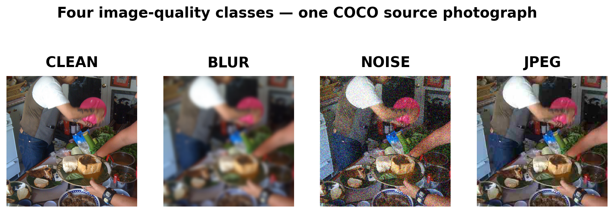
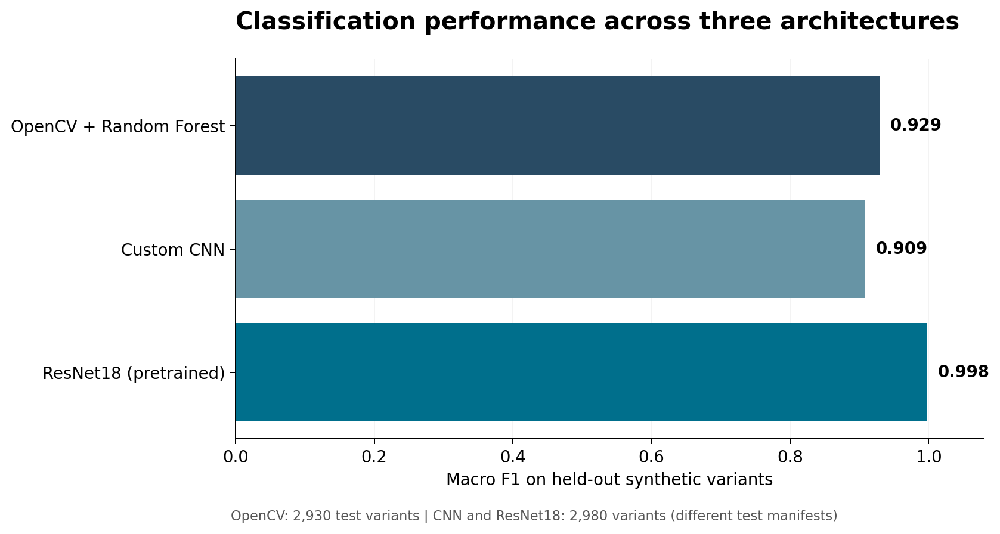
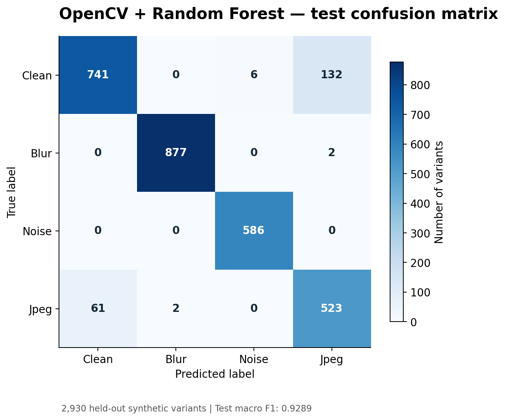
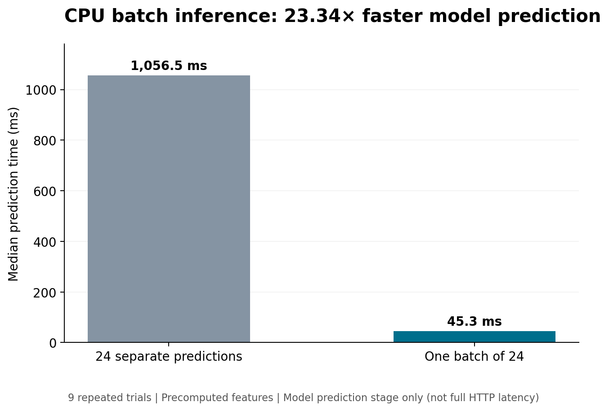

# Image Quality & Corruption Detection

An end-to-end computer vision project for detecting image-quality degradation using classical machine learning, deep learning, and transfer learning.

Built with Python, OpenCV, PyTorch, scikit-learn, FastAPI, and Docker.

## Overview

Developed a four-class image classifier to distinguish between clean, blurred, noisy, and JPEG-compressed images. The project explores different modeling approaches, evaluates classification performance, and optimizes CPU inference for efficient deployment.

The pipeline uses 2,000 photographs from the COCO dataset to generate 20,000 labeled image variants. Training, validation, and test sets are separated by original source image to prevent data leakage.

### Example Image Corruptions



## Model Performance

Implemented and evaluated three classification approaches:

| Model | Macro F1 |
|---|---:|
| OpenCV Features + Random Forest | 0.9289 |
| Custom PyTorch CNN | 0.9086 |
| ResNet18 (Transfer Learning) | 0.9981 |

### Model Comparison



*Scores were measured on source-separated synthetic test sets. The OpenCV experiment used 2,930 images, while the CNN and ResNet18 experiments used 2,980. Results are therefore not from an identical test split.*

ResNet18 achieved the highest score on the original synthetic test distribution. An exploratory evaluation using alternative corruption methods identified potential robustness limitations that require further investigation.

### Classification Error Analysis

The OpenCV/Random Forest classifier performed well on blur and noise detection, with most misclassifications occurring between clean and JPEG-compressed images. The confusion matrix below shows its performance on 2,930 held-out synthetic variants.



## Key Features

- **Image Processing:** Generated labeled variants across four image-quality classes using OpenCV.
- **Model Development:** Compared handcrafted image features, a custom convolutional neural network, and pretrained ResNet18.
- **Performance Evaluation:** Measured macro F1, precision, recall, and confusion matrices, with detailed error analysis by corruption type and severity.
- **Inference Optimization:** Improved CPU inference efficiency through vectorized batch prediction.
- **API Development:** Built a FastAPI application supporting individual and batch image classification.
- **Containerization:** Dockerized the inference API for reproducible local deployment.
- **Testing:** Implemented automated tests for inference behavior and invalid inputs.


## CPU Inference Optimization

Vectorized batch prediction reduced CPU model-prediction
time by approximately 23× compared with sequential
prediction calls for 24 images.



*Measurements cover the model-prediction stage only,
excluding preprocessing and HTTP overhead.*

## Technology Stack

**Languages:** Python

**Machine Learning:** PyTorch, scikit-learn, torchvision

**Computer Vision:** OpenCV, Pillow

**Model Evaluation:** NumPy, pandas, scikit-learn metrics

**Backend & Deployment:** FastAPI, Docker, Uvicorn

**Testing:** pytest

## Getting Started

### Installation

```bash
git clone https://github.com/snehasunill/image-quality-corruption-detection.git
cd image-quality-corruption-detection

python3 -m venv .venv
source .venv/bin/activate
pip install -r requirements.txt
```

### Run Tests

```bash
pytest -q
```

### Start the API

```bash
MODEL_DIR=artifacts/opencv uvicorn api:app --host 127.0.0.1 --port 8000
```

Open `http://localhost:8000/docs` to explore the API.

### Run with Docker

```bash
docker build -t image-quality-api .
docker run --rm -p 8000:8000 --name image-quality-api image-quality-api
```

The deployed API uses the trained OpenCV/Random Forest model.

### API Endpoints

| Endpoint | Description |
|---|---|
| `GET /health` | Check API and model readiness |
| `POST /predict` | Classify an uploaded image |
| `POST /batch` | Classify multiple uploaded images |

## Dataset & Experiments

The dataset was constructed from 2,000 COCO source photographs, producing 20,000 synthetic image variants.

Original photographs and generated images are not included in this repository. Dataset-generation scripts, experiment metrics, evaluation reports, and model-training code are available in the project folders.

The repository includes the trained OpenCV model. CNN and ResNet18 training experiments were conducted using Google Colab with GPU acceleration.

### Experiment Results

- [OpenCV evaluation metrics](experiments/opencv_metrics/)
- [Dataset generation and split verification](experiments/full_dataset/)
- [Classification error analysis](experiments/error_analysis/)

## Project Structure

- `quality/` — Dataset generation, feature extraction, and model training
- `artifacts/` — Saved inference model
- `experiments/` — Evaluation metrics, benchmarks, and error analysis
- `notebooks/` — GPU training workflow
- `tests/` — Automated tests
- `api.py` — FastAPI inference service
- `Dockerfile` — Container configuration

## Future Improvements

- Evaluate robustness on an independent photographic dataset.
- Improve generalization across additional noise and compression methods.
- Explore further inference optimizations and deployment configurations.
